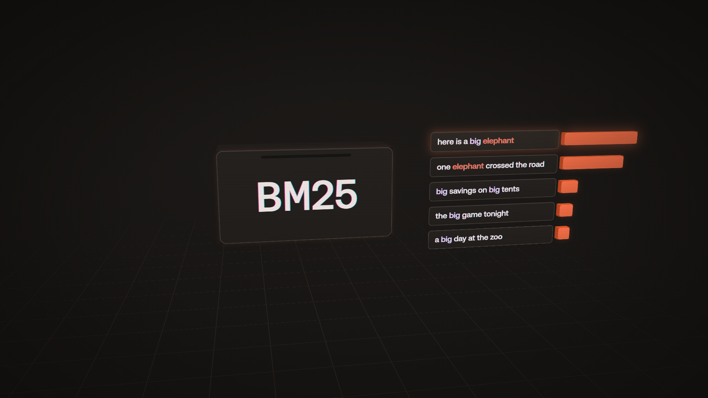
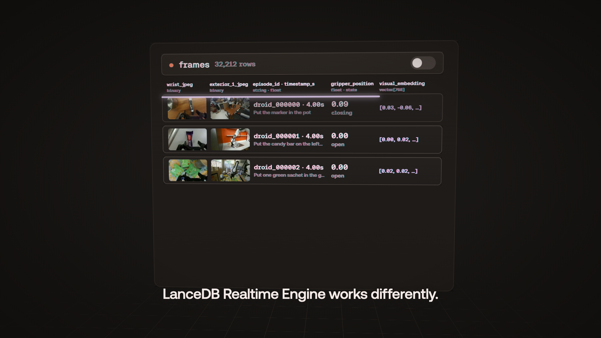

# LanceDB motion kit

How LanceDB makes its explainer videos (Feature of the Week episodes, launch
videos, 30-second social cuts, product tours) in
[Remotion](https://www.remotion.dev): a written method, the kits that define
the look, a voiceover-to-cues tool, and five shipped videos as working examples.



## The guide

Start here: **[`.claude/skills/lancedb-motion/SKILL.md`](.claude/skills/lancedb-motion/SKILL.md)**.
It's written as a Claude Code skill (open Claude Code in this folder and it's
picked up automatically), and it reads fine as a human guide too.

| step | read |
|---|---|
| 1. get the facts (PR, code, numbers) | [fact-checking](.claude/skills/lancedb-motion/references/fact-checking.md) |
| 2. plan one picture per VO line, one world | [planning](.claude/skills/lancedb-motion/references/planning.md), [recipes](.claude/skills/lancedb-motion/references/recipes.md) |
| 3. time it to the voiceover | [timing-and-cues](.claude/skills/lancedb-motion/references/timing-and-cues.md) |
| 4. build with the kit, in the house style | [kit-reference](.claude/skills/lancedb-motion/references/kit-reference.md), [visual-language](.claude/skills/lancedb-motion/references/visual-language.md) |
| 5. assemble for the format (FOTW, launch, social 16:9/9:16, tour) | [formats](.claude/skills/lancedb-motion/references/formats.md) |
| 6. QA, render, hand off | [qa-and-render](.claude/skills/lancedb-motion/references/qa-and-render.md) |
| 7. sound | [sound](.claude/skills/lancedb-motion/references/sound.md), [`docs/SFX-GUIDE.md`](docs/SFX-GUIDE.md) |

## Evals

[`evals/`](evals/README.md) checks whether the guide works: an agent builds scenes from
a voiceover line (with and without the guide), and each scene is scored on
whether it builds, follows the house rules, looks right, and tells the script.

## Start

Needs Node 18+, plus `ffmpeg` and [`uv`](https://docs.astral.sh/uv/) for the cue tool.

```bash
npm i
npm run dev          # Remotion Studio: scrub every composition
npx remotion render StarterScene out/starter.mp4
npx remotion still Ep07-RankMachine out/rank.png --frame=700

uv run tools/vo_cues.py transcribe vo.wav --out vo.words.json   # VO → word timings
uv run tools/vo_cues.py cues vo.words.json cuespec.json --out src/cues.ts
```

## What's where (`src/`)

| file | what |
|---|---|
| `lanceTheme.ts`, `lanceFonts.ts` | **the** colors and fonts. Nothing else defines a color. |
| `boldKit.tsx` | the current explainer kit: CSS 3D stage, camera paths, slabs with text on their faces, springs |
| `StarterScene.tsx` | template, copy it to start a new scene |
| `RankMachine.tsx` … `Reqs.tsx` | Ep. 07's ten explainers (real, shipped scenes) |
| `cues.ts` | Ep. 07's word cues: the frame each VO word lands on, per scene |
| `ftsData.ts` | the toy table + real BM25 bar lengths those scenes use |
| `Ep07Reel.tsx` | every Ep. 07 graphic at its real frame, how an episode is sequenced |
| `Intro.tsx`, `Outro.tsx` | show open / sign-off. Only change the episode number and text. |
| `sceneTransition.ts`, `WhooshStreaks.tsx`, `retro.tsx` | transitions, motion blur, the scanline/fringe grade |
| `NameCard`, `ContribIdent`, `CaptionLine`, `GlitchGrade` | host name cards, contributor idents, captions, seams |
| `stickerKit`, `gagKit`, `Confetti`, `*Gag.tsx` | the sticker/stamp gags |
| `diagramKit`, `readKit`, `ftsKit`, `PrPage3D` | older three.js kits. Only the PR page still uses one. |
| `../tools/vo_cues.py` | voiceover → word timestamps → `cues.ts` (see timing-and-cues) |
| `kinoCompat.d.ts` | types for two attributes the files carry from the editor they were built in; harmless |

## Other LanceDB videos (`src/examples/`)

Built with the same kits, each in its own self-contained folder (its own copy
of the kit files, so you can see exactly what each video shipped with). They're
in the **Examples** folder in Studio. Graphics and captions only: camera
footage, voiceover, music and SFX are left out.

| composition | what |
|---|---|
| `MemWAL-RealtimeEngine-Launch` | LanceDB Realtime Engine / MemWAL launch video (3:32): real-table explainers, rollout flow, results |
| `Lance-PocketDemo-16x9` / `-9x16` | ~47 s Lance pocket demo on real DROID robot data (MIT), horizontal and vertical |
| `Docs-Tour` | ~48 s versioned docs tour: 3D flight through docs.lancedb.com screenshots, CRT TV open/close |

The vertical one is the reference for 9:16: same kits, 1080×1920.



`docs/ep07-DECISIONS.md` is the full production log of a real episode (takes,
cuts, fact-check notes, SFX). `docs/SFX-GUIDE.md` is the sound recipe.

## Assets

- `public/lancedb-logo-offwhite.png`: used by the outro.
- `public/avatar-placeholder.svg`: drop a contributor's GitHub avatar in
  `public/` and pass it as `avatar={staticFile("name.png")}` to `ContribIdent`.
- Fonts load at render time from LanceDB's website CDN (needs network).

Pinned to Remotion 4.0.540. Check Remotion's license terms for company use.
